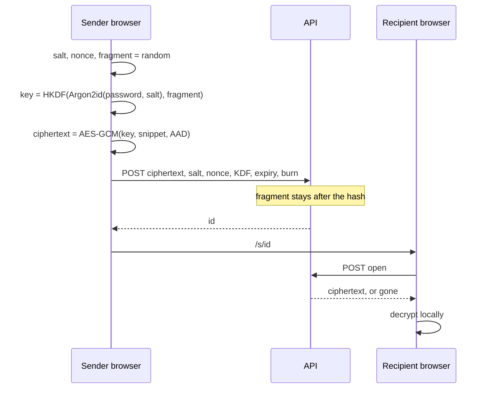

# hash

[](https://github.com/corporatelabs/hash/actions/workflows/ci.yml)
[](https://scorecard.dev/viewer/?uri=github.com/corporatelabs/hash)
[](https://www.bestpractices.dev/)

Share a secret by a short link. The browser encrypts it. The server stores ciphertext only.

The hosted instance is <https://hash.corporatelabs.ai>. This repository does not deploy it. The custom-domain route in `wrangler.jsonc` stays commented until you opt in. See [RELEASING.md](RELEASING.md).

There is no account and no recovery. Lose the password or the link, and the secret is gone.

## How it works



Argon2id uses 64 MiB, t = 3, p = 1. That KDF is the vendored hash-wasm 4.13.0 build, because WebCrypto has no Argon2. HKDF-SHA-256 mixes in a 256-bit fragment from the URL. AES-256-GCM is WebCrypto. Additional data binds the id, salt, expiry, burn flag, and KDF parameters. The API and the Node server use no runtime npm packages. Details are in [DEPENDENCIES.md](DEPENDENCIES.md) and [THREAT_MODEL.md](THREAT_MODEL.md).

One-time snippets are deleted in the same storage operation that returns them. The server cannot check the password, so a wrong password on a burn link destroys the ciphertext. The page says so.

## Deploy the Worker

Node 22 (see `.nvmrc`). `better-sqlite3` publishes prebuilds for that line. Node 24 has no prebuild yet, and `engine-strict` makes `npm ci` stop instead of compiling.

```bash
nvm use
npm ci
npx wrangler login
openssl rand -base64 32 | npx wrangler secret put RATE_LIMIT_PEPPER
```

Uncomment `routes` in `wrangler.jsonc`:

```jsonc
"routes": [
  { "pattern": "hash.corporatelabs.ai", "custom_domain": true }
]
```

```bash
npm run build:client
npx wrangler deploy
```

The Worker name is `hash`. Durable Objects are `SnippetObject` (`SNIPPETS`) and `RateLimiter` (`RATE_LIMITER`), SQLite-backed, migration `v1`. There is no account id in the config. `RATE_LIMIT_PEPPER` is not a var. Putting it in `wrangler.jsonc` would make the next `wrangler deploy` replace the production secret with that value. Production creates and opens return 503 until the secret is set, and they also refuse the development placeholder.

Local Worker dev reads `.dev.vars`, which Wrangler does not upload:

```bash
cp .dev.vars.example .dev.vars
npm run dev
BASE_URL=http://127.0.0.1:8787 node scripts/roundtrip.mjs
```

## Self-host

```bash
docker build -t hash .
docker run --rm -p 8080:8080 \
  -e ENVIRONMENT=development \
  -e RATE_LIMIT_PEPPER=development-only-pepper \
  -v hash-data:/data \
  hash
```

For a real host, set `ENVIRONMENT=production` and a unique pepper of at least 16 characters. The image exits if production is missing a pepper or is given the development placeholder. SQLite is the default (`DATABASE_PATH=/data/hash.sqlite`). Redis is `STORAGE=redis` and `REDIS_URL`.

```bash
docker compose up --build
STORAGE=redis docker compose --profile redis up --build
```

Compose defaults to development and the placeholder so a laptop can boot. Do not expose that configuration.

## Develop

```bash
npm ci
npm test
npm run lint
npm run typecheck
```

Node 22. Tests cover the crypto vector, both storage backends (Redis on `REDIS_URL`), the Worker, and a Node create/open path. [CONTRIBUTING.md](CONTRIBUTING.md), [SECURITY.md](SECURITY.md), [CODE_OF_CONDUCT.md](CODE_OF_CONDUCT.md).

Publishing images is gated. [RELEASING.md](RELEASING.md) lists the variable and secrets, which are intentionally unset.

Scorecard and the Best Practices badge start working after the repository is public and, for Best Practices, after you replace `PLACEHOLDER` with the project id from <https://www.bestpractices.dev/>.

## License

MIT. See [LICENSE](LICENSE). Fonts in the client are SIL Open Font License (Newsreader, IBM Plex Mono). Argon2 in the browser is [hash-wasm](https://github.com/Daninet/hash-wasm) (MIT).
