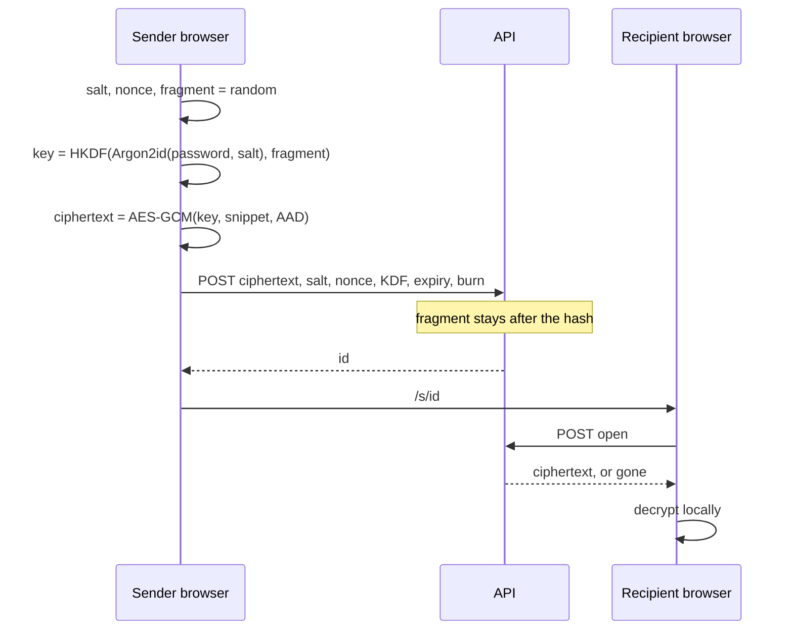

# hash

[](https://github.com/corporatelabs/hash/actions/workflows/ci.yml)
[](https://scorecard.dev/viewer/?uri=github.com/corporatelabs/hash)
[](https://github.com/corporatelabs/hash/blob/main/LICENSE)
[](https://github.com/corporatelabs/hash/pkgs/container/hash)

Share a secret by a short link. The browser encrypts it. The server stores ciphertext only.

There is no account and no recovery. Lose the password or the link, and the secret is gone.

A hosted instance is at <https://hash.corporatelabs.ai>. Running it yourself is a container. This repository does not deploy either one.

## Run it

The published image is `ghcr.io/corporatelabs/hash`. Use a version tag, or `latest` for the newest non-prerelease release.

```bash
docker run --rm -p 8080:8080 \
  -e ENVIRONMENT=development \
  -e RATE_LIMIT_PEPPER=development-only-pepper \
  -v hash-data:/data \
  ghcr.io/corporatelabs/hash:latest
```

Open <http://127.0.0.1:8080>. The link you send uses the origin in the browser, so put the container behind the host name you want people to open.

Check the signature before you trust the image. The identity is the publish workflow on a release tag:

```bash
cosign verify \
  --certificate-identity-regexp '^https://github.com/corporatelabs/hash/\.github/workflows/publish\.yml@refs/tags/v.+' \
  --certificate-oidc-issuer 'https://token.actions.githubusercontent.com' \
  ghcr.io/corporatelabs/hash:latest
```

A manual publish from `main` is signed as `@refs/heads/main` instead of a tag. The image is `linux/amd64` and `linux/arm64`. It has no extra runtime packages. SQLite is Node's built-in `node:sqlite`.

Build this repository instead of pulling:

```bash
docker compose up --build
```

Redis is optional. The default image does not load it.

```bash
docker compose --profile redis up --build
```

For a host other than your laptop, set `ENVIRONMENT=production` and a unique `RATE_LIMIT_PEPPER` of at least 16 characters. The process exits if production is missing a pepper or is given the development placeholder. Do not publish the compose defaults.

| Variable | Default in the image | What it does |
| --- | --- | --- |
| `ENVIRONMENT` | `production` | `production` refuses the development pepper. `development` is for a laptop. |
| `RATE_LIMIT_PEPPER` | unset | Required. At least 16 characters. Mixes into rate-limit buckets. Not a decryption key. |
| `STORAGE` | `sqlite` | `sqlite` or `redis`. |
| `DATABASE_PATH` | `/data/hash.sqlite` | SQLite file. Mount a volume here. |
| `REDIS_URL` | unset | Required when `STORAGE=redis`. |
| `PORT` | `8080` | Listen port. |
| `TRUST_PROXY` | unset | Set `true` only behind a proxy that overwrites `X-Forwarded-For`. Otherwise the socket address is the client. |

`docker-compose.yml` sets `ENVIRONMENT=development` and the placeholder pepper so `docker compose up --build` works locally. Change both before you expose it.

## How it works



Argon2id uses 64 MiB, t = 3, p = 1. That KDF is the vendored hash-wasm 4.13.0 build, because WebCrypto has no Argon2. HKDF-SHA-256 mixes in a 256-bit fragment from the URL. AES-256-GCM is WebCrypto. Additional data binds the id, salt, expiry, burn flag, and KDF parameters. The API and the Node server use no runtime npm packages. Details are in [DEPENDENCIES.md](DEPENDENCIES.md) and [THREAT_MODEL.md](THREAT_MODEL.md).

One-time snippets are deleted in the same storage operation that returns them. The server cannot check the password, so a wrong password on a burn link destroys the ciphertext. The page says so.

## Optional: Cloudflare Workers

The same API can run as one Worker with two Durable Objects. Bindings stay `SNIPPETS` (`SnippetObject`) and `RATE_LIMITER` (`RateLimiter`). The migration tag stays `v1`. There is no account id in `wrangler.jsonc`. The custom-domain route stays commented until you opt in.

`RATE_LIMIT_PEPPER` is a secret, not a var. A var would make the next deploy overwrite the production secret.

```bash
nvm use
npm ci
npx wrangler login
openssl rand -base64 32 | npx wrangler secret put RATE_LIMIT_PEPPER
npm run build:client
npx wrangler deploy
```

Local Worker dev reads `.dev.vars` (see `.dev.vars.example`), which is not uploaded. `npm run dev` starts it. The steps and the route snippet are in [RELEASING.md](RELEASING.md).

## Develop

```bash
npm ci
npm test
npm run lint
npm run typecheck
```

Node 26. `npm run dev:node` is the local server. Tests cover the crypto vector, SQLite, Redis (on `REDIS_URL`), the same HTTP checks against the Node server and the Worker, and a real encrypt/decrypt round trip. `scripts/check-core-boundary.mjs` fails if `src/core` or `src/shared` imports Cloudflare, Wrangler, an adapter, or a storage backend. [CONTRIBUTING.md](CONTRIBUTING.md), [SECURITY.md](SECURITY.md), [CODE_OF_CONDUCT.md](CODE_OF_CONDUCT.md).

Publishing images waits on the `PUBLISH_ENABLED` variable. [RELEASING.md](RELEASING.md) lists that switch. The Scorecard badge fills in after the Scorecard workflow publishes a result. The OpenSSF Best Practices badge is not linked yet. Enrollment is a manual step in that same document.

## License

MIT. See [LICENSE](LICENSE). Fonts in the client are SIL Open Font License 1.1 (IBM Plex Sans, IBM Plex Mono). Argon2 in the browser is [hash-wasm](https://github.com/Daninet/hash-wasm) (MIT).
