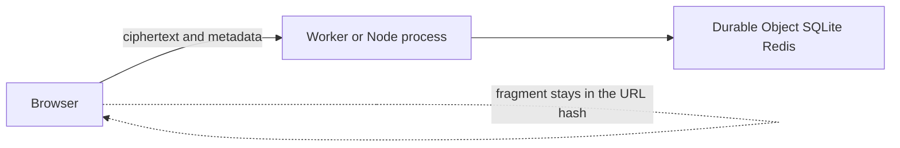

# Threat model

hash is a short-lived paste. The sender's browser encrypts a snippet. The recipient's browser decrypts it. The server stores ciphertext and non-secret metadata. Version 1 has no accounts.

This document uses STRIDE. It is a design record, not a pentest report.

## Assets

| Asset | Where it lives |
| --- | --- |
| Plaintext | Sender and recipient browsers only |
| Password | Typed in the browser. Normalized to NFC. Never sent. |
| Fragment secret | URL fragment `#k=`, 256 bits. The browser does not put it on the wire. |
| Ciphertext, salt, nonce, KDF parameters | Worker Durable Object, SQLite file, or Redis |
| Expiry, burn flag, id | Same stores, and the link path |
| Rate-limit pepper | Worker secret or host environment variable |

There is no recovery. A lost password or a lost fragment means the plaintext is gone.

## Trust boundaries

The hosted deployment is a Cloudflare Worker at <https://hash.corporatelabs.ai>. The same API runs in a container you operate. Trust in the platform is different in those two places. The cryptography is the same.

## Crypto

- KDF: Argon2id via hash-wasm, m = 64 MiB, t = 3, p = 1, 16-byte salt, 32-byte output. p = 1 is a deliberate departure from RFC 9106's second recommendation (p = 4) because the WASM build is single-threaded.
- The AES-256 key is HKDF-SHA-256 over that output. The HKDF salt is the fragment secret. Info is `hash-v1-aes-256-gcm`.
- Encryption is AES-256-GCM, 96-bit nonce, 128-bit tag, WebCrypto only.
- Additional authenticated data binds version, id, salt, expiry, burn flag, and KDF parameters. A swapped or edited record does not decrypt.
- The client refuses KDF parameters other than v1, and the library refuses memory or iteration counts above v1, so a malicious response cannot ask the browser for a multi-gigabyte Argon2 run.
- The server accepts only the v1 parameter set, so a modified client cannot store a snippet under a weak KDF.

Anyone who has the ciphertext, the salt, and the fragment can still guess the password offline. The fragment is what stops the server, or a database thief who does not have the link, from doing that alone. Anyone who has the link but not the password learns nothing. Both are required.

## STRIDE

| Threat | Where | What we do | What remains |
| --- | --- | --- | --- |
| Spoofing | API client | No accounts. The id is 128 random bits. The fragment is 256 bits and is not an authenticator the server checks. | Anyone with the link and the password can read. That is the product. |
| Tampering | Stored record, response metadata | AES-GCM and AAD. Idempotent create does not overwrite a different payload. | A malicious server can delete or withhold data. It cannot show a forged plaintext that decrypts. |
| Repudiation | Create and open | Structured logs without ids, ciphertext, passwords, or fragments. | Operators can still see request paths in platform traces. We do not claim an audit trail of who read a secret. |
| Information disclosure | Server, logs, backups, Redis | Server never receives plaintext, password, or fragment. `Referrer-Policy: no-referrer`. Cache-Control `no-store` on responses. | Metadata below. Ciphertext is still confidential only as far as the password and fragment are. |
| Denial of service | Create, open, storage | Per-IP fixed windows: 10 creates and 30 opens per 10 minutes. Body cap. 64 KiB plaintext cap. | Distributed clients and a missing or spoofable client IP. Argon2 cost is paid by the browser, which also protects the server. |
| Elevation | Worker, container, Durable Object | The Worker does not import storage drivers or the KDF. Production refuses the development pepper. Container runs as uid 65532. | A bug in the host or a stolen pepper does not decrypt data, but it can delete it or bypass rate limits. |

## Scenarios

### Malicious or compromised server

The server can store, copy, or delete ciphertext. It can lie about expiry in the database. It cannot produce a fragment it never saw, and GCM rejects a record whose AAD does not match what the client rebuilds from the response. It cannot check the password, so it cannot tell a wrong password from a tamper.

A compromised host that also sees the link (a proxy that logs the fragment, which browsers do not send, or a person who was given the link) is outside the model. Do not terminate TLS in a place that records URL fragments. Browsers do not send fragments. A malicious page on the same origin could.

### Ciphertext leak and offline guessing

A database backup is an offline guessing problem only for someone who also has the fragment. Without the fragment, Argon2 output is not useful: the AES key is HKDF(Argon2(password, salt), fragment). With the fragment, guessing cost is about one 64 MiB Argon2id evaluation per try. Weak passwords fall. The UI blocks the shortest and most common ones and offers a generated password of about 116 bits. That block is not a substitute for a password manager.

### Link leakage

The link is the id plus the fragment. Chat apps and some mail gateways drop fragments. The recipient then cannot decrypt, which fails closed. People who forward the full link share both factors except the password. Send the password on a different channel when it matters.

The id is in the path, so it appears in Worker request logs and in traces. The id does not decrypt. Do not add the fragment to a query string, an analytics call, or a `Referer`.

### Weak passwords

A short human password is the weak point once the link has leaked. Generated passwords avoid ambiguous characters and are grouped so they can be read aloud. The strength meter is a heuristic, not a cracker. Production KDF parameters are the ones in `src/shared/protocol.ts`. Tests may use a tiny KDF only behind an explicit flag the server rejects.

### XSS and supply chain

The page is static, self-hosted, and has no inline script. The content security policy is `default-src 'none'` with `script-src 'self' 'wasm-unsafe-eval'` (hash-wasm compiles WebAssembly), `worker-src 'self'`, and no third-party hosts. Snippets are inserted with `textContent`. Subresource integrity covers the document's script and stylesheet. The crypto worker is same-origin. `Worker` still has no reliable integrity attribute, so we do not widen `worker-src` to `blob:`.

Dependencies are pinned by the lockfile. CI fails closed on GPL-family and similar copyleft licenses. A compromised npm package that runs in the browser can read the password. Review updates to hash-wasm with that in mind. Fonts are SIL OFL and self-hosted.

### Metadata leakage

The server and anyone with the id learn that a snippet exists, when it expires, whether it burns, and its ciphertext length. Tombstones remember "expired" or "burned" for 24 hours so the recipient sees a clear reason. That is a small existence oracle. Ids are 128 bits, so guessing is not the way in. Platform logs that store the path remember the id. We do not log bodies.

`createdAt` is stored for the operator and is not returned by the API. It is not in the AAD, so it is not authenticated.

### Enumeration

Open and create are rate limited. Ids are 128-bit base64url. Different errors for missing, expired, and burned are safe at that size and are what the UI needs. On Cloudflare, the client address is `CF-Connecting-IP`, which the platform sets. In local development the address falls back to a shared `local` bucket.

### Replay

Replaying a create with the same id and payload is idempotent. A different payload for that id conflicts. Replaying an open of a burned snippet returns gone. The GCM nonce is random per seal. Replaying the link before expiry is the feature.

### Burn before the password is checked

The server deletes a one-time ciphertext in the same transaction or Lua script that returns it. Decryption happens afterwards in the browser. A wrong password on a one-time link destroys the ciphertext. The UI says so. The alternative is a confirm step the server cannot verify, which a second client can skip.

SQLite uses `DELETE ... RETURNING` inside an immediate transaction. Redis uses one Lua script. The Durable Object uses `transactionSync` and the same delete. Tests open the same id concurrently and require exactly one success.

### Self-hosted deployments

| Topic | Note |
| --- | --- |
| Host compromise | The operator can read ciphertext and metadata. They still need the fragment and password for plaintext. |
| SQLite file and Redis | Treat them as confidential backups. `secure_delete` is on for SQLite. Redis memory is not wiped. Put a password on Redis and do not expose it. |
| `TRUST_PROXY` | Off by default. Turn it on only behind a proxy that overwrites `X-Forwarded-For`. If the process is reachable directly with trust enabled, clients pick their rate-limit bucket. |
| Docker | The image runs as uid 65532. A read-only root needs a writable `/data` volume and a tmpfs on `/tmp`. Do not mount the Docker socket into the container. |
| Pepper | Production startup fails if `RATE_LIMIT_PEPPER` is missing or is `development-only-pepper`. The placeholder exists so `npm run dev` and local Compose work. It is not a production secret. With a public pepper, IPv4 addresses can be brute-forced out of rate-limit keys. |
| Expiry | Durable Objects alarm at `expiresAt`. SQLite and Redis also expire on read and on a one-minute sweep. Unread Redis ciphertext is deleted by the sweep or by the key TTL, whichever runs. |
| Test environment | `ENVIRONMENT=test` accepts expiries in the past so tests can simulate expiry. Do not run it on a public host. |

## Out of scope

Account recovery, malware on the sender's or recipient's machine, a stolen unlocked browser, and a person who was given the password and the full link.
